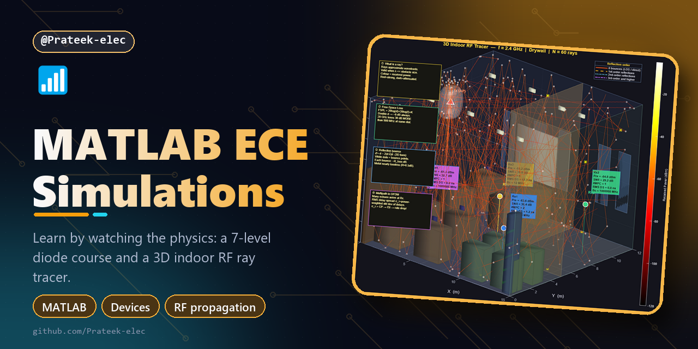
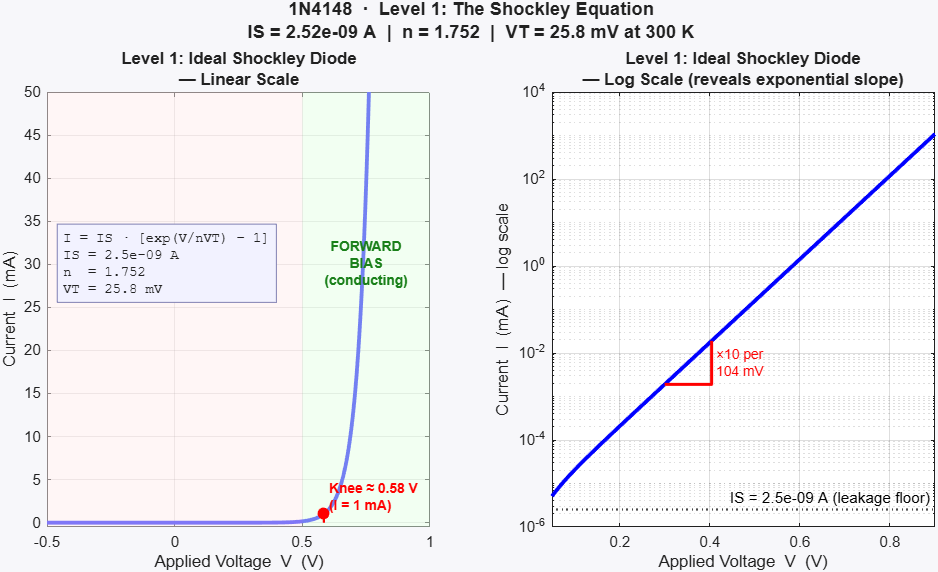
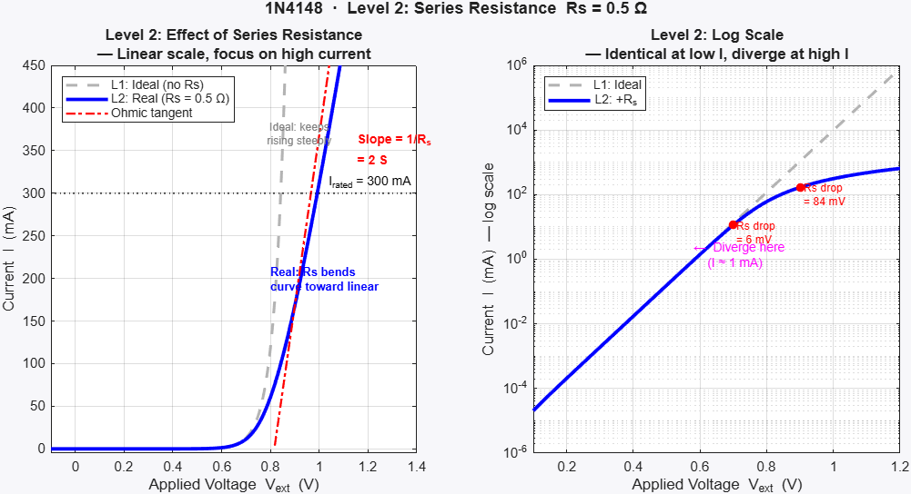
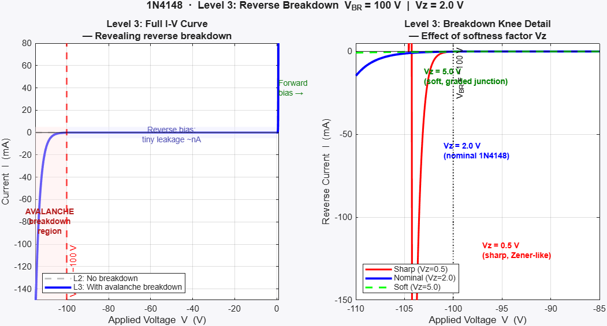
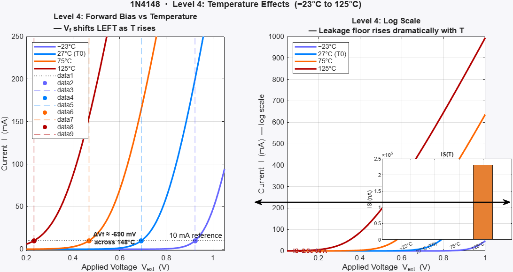
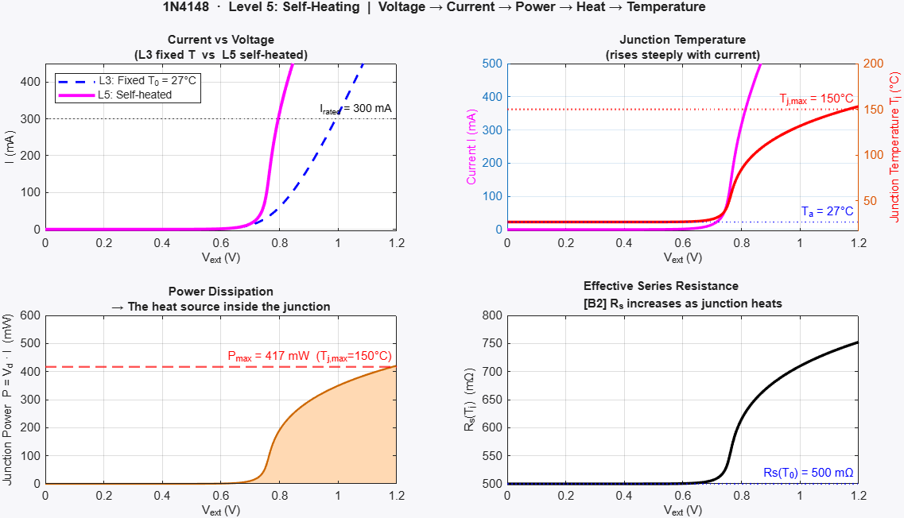
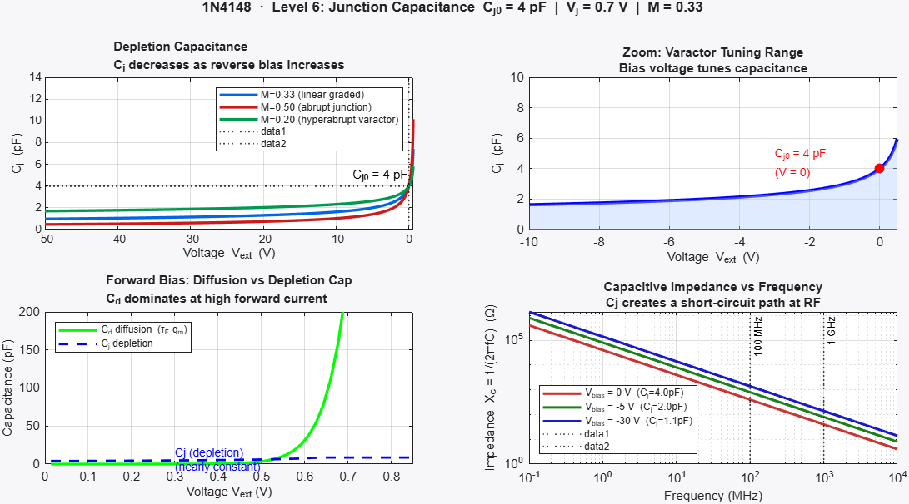
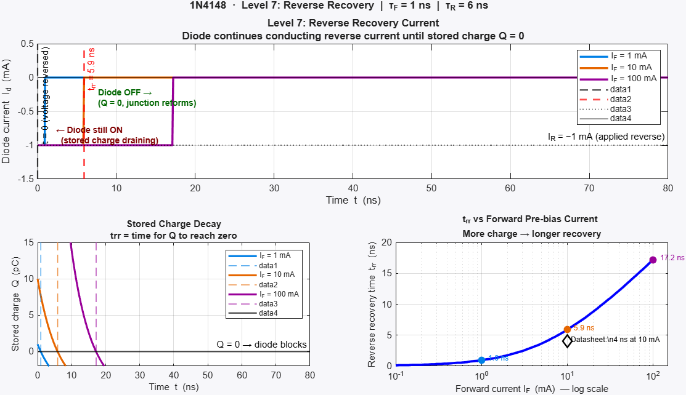
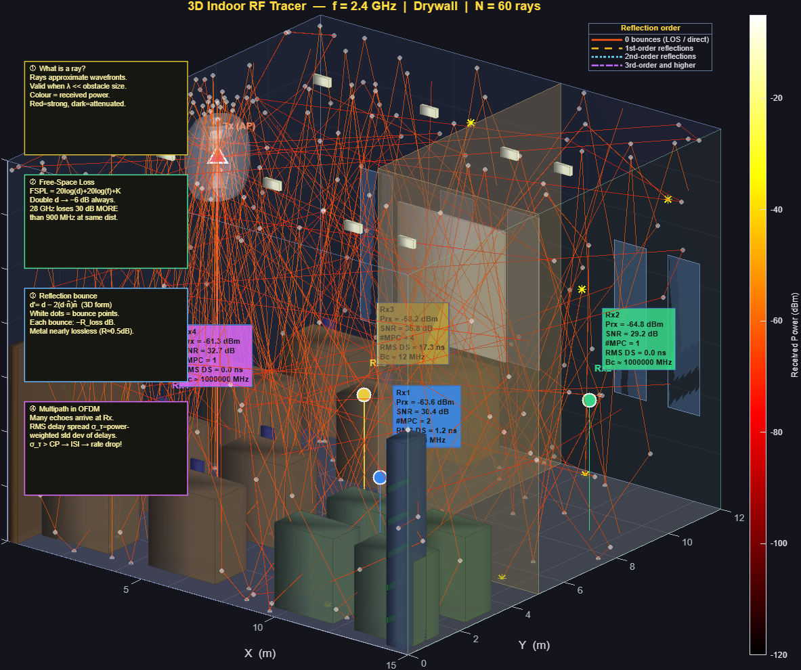

<div align="center">



**Visual MATLAB simulators for electronics and communication engineering: a 7-level course on the 1N4148 diode, and an interactive 3D indoor RF ray tracer.**


</div>

---

## 🔥 Why it hits different

- 📈 **One concept per level:** the diode course adds exactly one new physical effect at a time, from Shockley to reverse recovery.
- 🛰️ **See Wi-Fi bounce around a room:** 3D rays, reflections, path loss, SNR and delay spread per receiver.
- 🧮 **Real physics, not cartoons:** Newton-Raphson I-V solver, SPICE-style temperature scaling, FSPL and multipath statistics.
- ▶️ **Runs out of the box:** every script was run in MATLAB R2026a and produced the figures below.

## 1. DiodeTutor: the 1N4148 diode in 7 levels

```matlab
cd diode-tutor
DiodeTutor          % level menu
DiodeTutor(3)       % jump to Level 3
Level5_SelfHeating  % or run any level directly
```

| Level | Concept | |
|---|---|---|
| 1 | Shockley equation |  |
| 2 | Series resistance |  |
| 3 | Reverse breakdown |  |
| 4 | Temperature effects |  |
| 5 | Self-heating feedback |  |
| 6 | Junction and diffusion capacitance |  |
| 7 | Reverse recovery |  |

Shared physics lives in `diode_params.m` (1N4148 model), `IS_T.m` (temperature-scaled saturation current) and `solveI.m` (Newton-Raphson I-V solver). `vi_diode_intro.m` is the original one-page warm-up. Full guide: [diode-tutor/README.md](diode-tutor/README.md).

## 2. Indoor RF ray tracer



```matlab
cd rf-ray-tracing
simulation_v3            % opens the interactive simulator
help simulation_v3       % concept map
```

A furnished office at 2.4 GHz: rays launched from the access point reflect off walls and furniture, colour-coded by received power. Each receiver reports received power, SNR, number of multipath components, RMS delay spread and coherence bandwidth, with on-screen notes explaining each idea.

## Fixes made when publishing

The original scripts didn't run as-is. These changes were made so they do:

| File | Problem | Fix |
|---|---|---|
| `diode_utils.m` | Held 5 helper functions in one file, but MATLAB only lets other files call the first one, so every level failed with *"Unrecognized function diode_params"* | Split into `diode_params.m`, `IS_T.m`, `solveI.m`, `print_separator.m` and `heading.m` |
| `Level3_Breakdown.m` | A Python-style `for [a, b, c] = …` loop (invalid MATLAB) with an empty body | Removed; the plot is unchanged |
| `simulation_v3.m` | Annotation boxes read a cell table as structs (`cs{k}.String`), which crashed on start | Read the table directly (`cs{k,4}`, `cs{k,2}`) |
| `v-i diode.m` | File name with a space and hyphen can't be called by name | Renamed to `vi_diode_intro.m` |

**Small things still worth polishing:** Level 4's "log scale" panel uses a linear axis, and a few legends show leftover `data1…` entries.

---

<div align="center">

**Built with ☕ and solder by [@Prateek-elec](https://github.com/Prateek-elec)**

</div>
